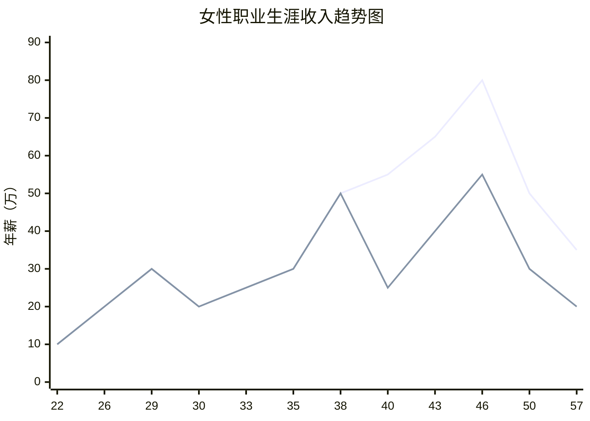
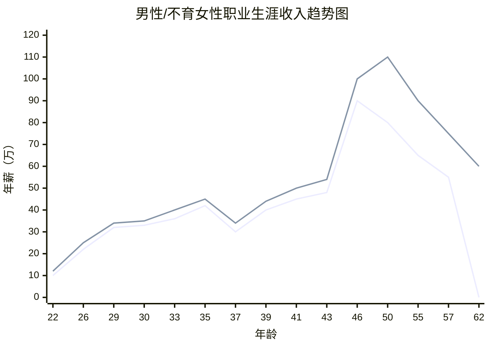

> 🍭点击标题查看阳澄湖大闸蟹聚会详情

---

回到今天的主题，“曾做过总监，有必要低就主管甚至职员岗位吗？”

很多东西大道至简，曾经做过总监，哪怕董事长，现在你没落了，人生走向了下坡路，自然也是可以低就经理、主管、职员哪怕助理岗位的。先有再优，先回到职场再进一步发展，先低姿态做小兵再从实践中提升职位，这才有这个成语“东山再起”的语境。

大家看明星，几乎每一个明星都会过气，至少走下坡路。花无百日红，该低头就低头，总有做低伏小演配角的时候。你过分高傲，但已经过了花期，风头不在了还硬要去做主角，这会导致你没戏可拍，作为演员你的自我修养再好，那也不过在家孤芳自赏。

因此，大家对于曾经的明星后来去做直播、改行做游戏推广大使，甚至婚庆主持人，要给予宽容，甚至要敬佩他们有这个勇气，拿得起放得下。即使还算年轻，也有可能时运不济，或者走了下坡路，此时不要气馁，小角色也要做，什么山上唱什么歌，什么时候做自己相配的角色。

我们看周星驰的电影，为何很多时隔多年才被人发现并称颂？因为他的电影几乎每一部都是讲人生故事，他的电影里大多是在讲人生起落，都有落魄的桥段甚至背景。这个道理运用到普通人身上也是如此，无论事业还是生活，每个人都有他的高光时刻。

看一个人是否有韧性，不是看他在百尺竿头如何更进一步，而是看他在没落之谷如何反弹。大多数人甚至都没辉煌一次，此后就一蹶不振，所以中年发迹和东山再起，都是非常值得钦佩的，十人中能出其一，就已经是很高的概率。我是希望你能在低谷时，成为那个不是自我放逐的人，至少在中年危机之后还能不好面子，再战职场，最终才能有常青的事业。

只会等、靠、要，动不动抱怨老天不公，羡慕他人运气好，说父母没本事给自己托举，埋怨家里没给自己安排稳定的工作，哪怕找了份稳定的工作就沾沾自喜甚至津津乐道于自己稳定的贫穷，都不是积极之举。

人生来世上走一遭，又不是为了最大限度地节约生存的成本。如果躺平或者逃避就是人生，那么这一辈子就太没有意思了。尽量不要消极，无论什么时候，这样不谈人类文明能有进步，至少你的家族不会因你而止步不前。

因此，从战术上来说，曾经做过总监的人，不但可以低就经理、主管、职员甚至助理岗位，而且你要先从总经理、副总开始投递自己的简历，重点还是你同一级的总监，实在尝试无解才去低就。

人生就是一条抛物线，第一个也是唯一的顶点出现在40岁前后，现在你就可以列出你身边尤其工作中遇到的45岁到70岁的人，那些老王老李老赵、张大婶王阿姨陈奶奶，他们哪一个不曾有过自己的高光时刻？如果其中某人现在还很积极进取、虚心学习，做事主动、认真、负责，满怀希望，这位就是特别值得尊敬的人。

之前讲过，我们的人生分为前半生：从小慢慢长大，身体和思想不断成熟，经过学校授予证书，成人了，进入社会，开始工作，熟悉职业，增加技能，发展事业，买房、结婚、置业，然后新生儿的出生，到此为止，是人一生中最幸福的时光，因为出生、出牙、说话、学步、学得、懂得、入职、提升、相知、相爱、成家……​**每一天都在带来希望，这就是前半生**​。

后半生则是从孩子出生开始，你需要且很可能面对的是：没钱、辅导班、学区房、孩子成绩不好、家长间攀比、裁员、失业、分离、孤独、丧失、父母离去、衰败、疾病、兄弟姐妹离去、子女没钱给孙子、自己成了“老不死”的……**这个过程鲜有希望，主要看你如何跟绝望相处。**

以上就是人生真知，也是很多人不愿意说的话。一开始都认为自己是特例，以为海阔凭鱼跃、天高任鸟飞，后来你才发现自己就是个普通人，是沧海一粟、凡夫俗子。

类比的例子就是，同样都是需要人负责吃喝拉撒睡，为何都更愿意照顾孩子而不愿照顾老人？因为孩子都能逐渐长大、懂事、独立并让人省心，老人则只会不断健忘、病痛、衰退还会发神经。

> 🍭实线：二胎年薪  虚线：正常年薪

我们每个人的事业生涯，无论体制内外，也都会经历这样一个前半生+后半生，中间连接着一个高光时刻。一般来说就是职位最高点，也是收入最高点。大多数人在抛物线的第一个顶点后，会走下坡路，此后再也没能爬得起来。

我希望我们群友、星友和读者，都能走向第二个顶点甚至第三个，见《》，你也顺便从上下两图中找下抛物线的第二第三个顶点在哪里。

> 🍭实线：男性 虚线：不育女性

来看下今天的星友案例，看他是多大岁数，曾经做到了多高的位置，什么性质的单位，目前如何，录取他的新工作是什么级别和工资，他的可选项有哪些......更为重要的是，你到了这一步，你怎么办。

> “幽哥你好，北方二线省会城市，女，职位最高本地一民企总监。”

北方二线省会城市，主要有石家庄、太原、沈阳、哈尔滨、长春、呼和浩特、乌鲁木齐、兰州。属于华北的就一个，所以你大概率在石家庄。

在石家庄的民企做过总监，但也看你这民企有多大。民企小的不足500人，中的千人以上，大的则人数上万。小民企的总监，无论工资、级别还是社会地位，大约等同于中等民企的经理，约等于大民企的主管。如果放到大型央企、国企、500强外企，则还需继续降级。这不是打击你，也不是庸俗，因为我们都身在世俗。

> “最近几年由于疫情、试用期招聘我的部门领导突然离职后的生存环境等原因，前后待了三个公司了。在此之前的15年在合资公司和外企有过稳定的职业履历。”

整体而言，就是最近五六年间，你待过3家公司，因种种原因，换工作比较频繁。在2005-2020的大约15年期间，你待过比如合资、外企各1家，还算稳定。

现在你进入社会20来年了，算22周岁本科毕业，则你大致是1982年出生，今年43岁，虚岁44。

> “目前离职找工作中，想请教幽哥：
  1、现在是先找个差不多的公司上班还是等待更好的规范民企或者外企机会？”

不知道你已经多久不上班，这跟下一步的求职目标息息相关，失业越久市场越不待见。比方你是去年底辞职的，至今大约有1年不在职。

你有两个目标，一叫差不多的公司，二是更好的更规范的民企和外企。但是这两类企业你都没有Offer，也就是你没拿到入职意向，你只是在纠结选哪一类型，这太早了。

原则是先有再优。你好歹“差不多”“差得多”“一点不差”以及“规范的”“不规范的”“非常规范的”，包括民企、外企、私企、合资、央企、国企、A股6000家上市公司、事业单位合同工、互联网巨头、新能源汽车、芯片行业公司，你得全部投递。

一开始要不分好坏，能获得面试尤其入职机会后，再去筛选好坏。做过总监，你总会明白总监也做不了无米之炊。

> “四十多了，感觉到了职场发展尾端，随便找一个担心又增加履历的不稳定性。但心仪的又不知何时等到，担心空窗期太长。”

你43岁，目前的女性退休年龄是58岁，大概率在你的同龄人退休时，退休年龄会延迟到68岁上下。你接下来的职业生涯还有最少15年，最长大概25年比你过去的工作年份还要长。因此，可能这次你不一定能恢复或者超过过去的总监职位及工资水平，但你还没到职场发展的尾端。15-25年不是尾端，好歹到了最后5-10年才算尾巴。

你已经很稳定了，20年待过5家公司，才跳槽4次，最近的也主要是疫情等客观原因。其他同龄人有20年工作经验的，大多待过10家公司了，多的30家，你换工作次数算少的，没啥不好意思的。因此，你不需要担心试错，大不了不合适就走，可以请新公司先不要帮你缴纳社保，你也可以通过入职前多考察来规避大坑。

等工作机会是等不到的，你得付诸行动，这才好解决你担心的空窗期问题。但是现在已经空窗1年，就无需在意继续多个求职周期3-4个月。你已经有了20年的工作经验，有一两年的空窗其实并不影响你过去长达20年积累的职业素质，也不影响你的学历、学识、管理能力和悟性等基本要素。因此，你对空窗期变长的担心，也是多余了。

> “2、原来做到民企总监，从职业发展来讲现在民企经理的offer要不要接受？”

当然接，接下来再细细评估。

接受是两个动作，你先“接”下来，答应入职，在1-2个月内也就是报到日之前，再去考虑要不要“受”。这期间如果找到更好的，就去更好的。

> “3、因最近三年跳槽频繁，年龄劣势，疫情机会又不多，目前有面试机会的多是民企。像我这种情况还能不能进个像样点的民企或者外企了？求幽哥给指条明路。”

难，你错失了大半年的就业时间，主要用来在家不上班不求职而是内心纠结，这属于内耗的范畴。你不行动，而是想着一切都确定了再做，那是计划经济思维比较顽固，这就贻误战机了。

当下经济下行，就业大行情不景气，见《》，你又处于经济发展水平一般且很重关系的石家庄，石家庄就业机会较少，不但低薪而且就业载体也没那么多，外企就更少了，还缺乏刚刚我所述的那些合资、上市公司、互联网、新能源、芯片等等巨头。你这次大概率找不到像样的外企、央企和国企，但找个像样或者一般样的民企，还是可以的。

先有再优，民企入职并转正后，再成年累月去边工作边物色合适的更好的工作机会，届时你也才有时间去耗。哪怕从44岁耗到50岁，找到那家更好的公司后，你还能度过职业生涯从50到68岁的剩余年份，也不短了，8-18年。

因此，在你从此刻开始的43岁，到退休前的15-25年，年份多到足够你东山再起，甚至从助理岗位发展到总经理、董事长、CEO了！

> “4、孩子今年初二，家庭与事业之间，如外地有更好的机会是否可考虑？之前有省内外地的外企猎头职位，考虑到孩子就都拒绝了。
  谢谢幽哥答复。”

你对自己要有信心，干一件事，除了需要体力，还需要心力，我这里再给你增加一个势商。也就是你要增加职业生涯的宽度，思维要进一步开阔。假如你上份工资年薪30万，则其他重点几个城市都可以投递，石家庄的工作机会只要给你年薪10-35万，都可以考虑，天津给你30-40万可去，北京50万，杭州苏州60万，上海70万可去，广州深圳和香港80万绝对可前往，国外做陆干超过100万也可以考虑。

“舍不得孩子”，下一句叫啥来着？孩子初二可以独立学习，让你的家人多多上心。你看下这篇《》，那些总监家庭幸福夫妻和谐为何啥工作都敢做？只要让他们年薪80万做总监，就愿意不远千里从长三角去珠三角，从东北去深圳，从北京去杭州，你为何石家庄不敢去天津、北京、青岛和上海？你已经算近的了。

你看如下截图，我的不外传干货，本不对外发布的，今天主要为了鼓励你继续做总监。但你可以先找个经理、主管哪怕普通职员工作做起来，此后再东山再起。

- 30万到60万(404)
  家庭和睦是女主管女经理年薪30-60万的人设。
  | 供应链&Sherry：为啥不营造家庭和睦的人设呢
- 1不咋瞎管事情不上身她都不在意
- **到了女总监女副总，就单身人设更好，这是突出女强人，狠的下心、不被家庭所累赘的人设，大老板才信得过她，合作的其他经理总监副总才会将她当做合作伙伴，而不是随时跑回家的猪队友。
  80万往上，都是单身人设更好。**
- 2悟了··人不狠站不稳
- 3那我还需要装一装稳定性···有个老公避免很多没必要的解释
  周五下午3:42
- 顶级的到了**女总经理**、女总裁、女老板、女省长、部长、副国级等级别，要有单身一辈子未婚的人设才更狠，哪怕有五六个老公十来个孩子，也是一辈子不婚人设更好。
  这才是做事业、成大事的非普通人。
  不将普通人吓唬住，你就成了普通人。
- 3太可怕了··难怪董大姐一辈子也没老公

别说主管、经理、总监了，连你将来提升到副总、总经理甚至更大的官，我上图中都写好了心法。至少你要能走出来，即使不离开家乡，你的思维先要能走出来。

祝你和各位曾经做过管理岗位、有过高光时刻的人，事业再接再厉，人人都能做总裁，一往无前，不要气馁！

End

---

大家求职，尽量将《[中国职场宝典](https://mp.weixin.qq.com/s/wDGw0Xf4jtk1T0dOUnmBLQ)》仔细研读，看过10篇文章后，跳个槽月薪增加50%，没问题。

