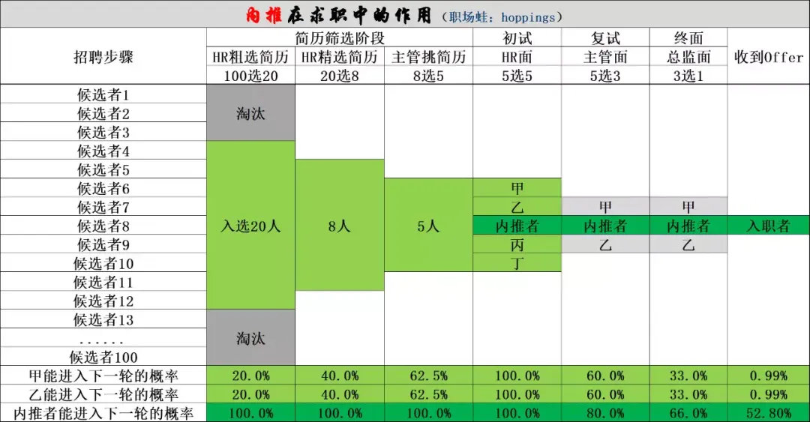

**我们**知道，投简历四大渠道，​**第一就是用招聘网站**​，在智联招聘、前程无忧、猎聘网等招聘门户网站和APP上海投。这个渠道的入职概率最低，一份简历投递出去，连个水泡都没有。因为这份简历的投递最终能入职的概率，最多1%罢了。

所以，用招聘网站投简历的人，如果不知道​**海**​，那就基本找不到工作，至少只能找到很差的工作。因为人家人事从招聘网站上收到的是海量的简历，你求职者个人却不去海投，还拿着职位和公司描述认真细致去研读并精准匹配，你就只能一天投递1-5份简历，你这是数量不对称，也是方法用错了地方。

**投简历第二个渠道**则是列出知名的企业作为你的目标东家，然后通过企业官网、公众号、微博、人事的自媒体发布等所谓的私域流量去投递，这叫​**定点投递**​，盯着这么十几家最多几十家定点守株待兔，尤其遇到新出来的岗位立马第一时间下手投递。

定点投递一份简历，最终能入职的概率大概5%，比海投稍有改善，但是很多大公司的官网、公众号等需要反复单独注册账号，还要做各种测试、声明、申请，比较麻烦，职位又没那么多，容易让人产生投递疲劳和厌倦感。

​**简历第三投递渠道则是猎头渠道**​，猎头渠道稍微好一点了，投递一份简历最终能入职的概率增加到了30%上下。可以这么说，如果你同一个月通过3家以上的猎头帮你推荐了各1个岗位，则你至少能获得一份工作机会的概率就提升到了接近100%（理论值是90%）。

猎头渠道的入职概率大幅提高了，甚至是招聘网站上海投简历的几十倍入职概率。但是不好的地方就是猎头是企业的付费招聘渠道，你入职后企业需要付给猎头大概折合你的月工资的2-3倍作为猎聘相关工作的报仇，这叫猎头费。因为收费较多，所以猎头对求职者比较挑剔。

比如企业要求“本科以上学历4年以上工作经验外语良好”，但是猎头的潜意识会修改成这样的要求：“本科（最好知名大学的硕士研究生）以上学历4年（最好6年）以上（相同行业相同岗位）工作经验外语良好（肯定要优秀）（气质佳、家庭稳定、来自大公司）”。

这一看就知道，猎头的要求是超过了企业部门和人事提出的要求，最好达到120%的标准，所以猎头对于求职者比较挑剔，你就类似他挑选来的“高级商品”，最好啥都超过基础要求才好。所以我让大家做的通用型用来海投的简历，碰到猎头，猎头一般都会让你再修改下以跟所面试的岗位更加匹配，这里就可以理解了，见《[**HR/猎头让我修改简历，究竟要不要修改？**](http://mp.weixin.qq.com/s?__biz=MzI0MzQ0OTUxOA==&mid=2247524900&idx=2&sn=643016325859f7a51135fc94be3631af&chksm=e96ec9e5de1940f37d5116def46fa4ea9b5b962f31dea2a97489eeb65dd070ef3284b31a85e3&scene=21#wechat_redirect)》。

​**求职者投递简历的第四也是最后一个渠道，自然是内部推荐**​，即通过该公司内部在职工作的员工，投递某个在招岗位，这样的入职概率就继续陡增到了50%以上，原理见这里《[**猎头帮我推荐了一个工作，我发现我有熟人在里面，我要不要也将简历发给熟人帮我内推？**](http://mp.weixin.qq.com/s?__biz=MzI0MzQ0OTUxOA==&mid=2247505208&idx=2&sn=caf1ced8b0b4d9a198dede40b7c6fb86&chksm=e96e7ef9de19f7efce1d2c4a681915182657d04c183588bed157ad40de63add5caa4cd707246&scene=21#wechat_redirect)》，推导过程如下图。



内推的入职概率的精确值在52.8%，我们取个约数50%吧。

所以内推入职的概率更高，但是毕竟你找不到几个人给你内推。有人说“我朋友多”，关键你这么多朋友所在的单位正好在你找工作的那两个月也在招人的，很少，至少概率比较低。

说到内推，我插播个今天的内推信息，群友小亮我的职场徒弟提供如下内推机会，工作地点苏州吴江，各位适合的投递。职场蛙后台回复“小亮”即可。

> 内推职位
> 1.混动及电动化产品开发经理 2.产品设计师-张紧轮/解耦器
> 3.项目经理 4.先期工艺工程师-电气
> 5.测试技术员 6.高级采购工程师(皮带厂)
> 7.物料计划员（皮带厂） 8.售后区域销售经理_商用车
> (苏州/广州/长沙)
> 内推奖励 职位 奖励 
> 部门主管/经理级以上 10000元
> 专业级员工 5000元
> 其他办公室岗位 2000元

他连内推成功入职后他能获得的内推奖金数额都发出来了，足见其诚意。他给你推荐的话，你的成功入职概率之理论值就是52.8%的样子。

所以内推入职的概率更高，但是毕竟你找不到几个人给你内推。有人说“我朋友多”，关键你这么多朋友所在的单位正好在你找工作的那两个月也在招人的，很少，至少概率比较低。

**综上，其实各个简历投递的渠道最终能获得的Offer数都差不多，入职概率小的需要海投，入职概率大的投不了几份简历。世界万事，本就如此。**

明白了以上投递渠道渠道的小结，我粗略做个导图如下。



下一个问题就要回到本文的标题了，你说企业招人如何获得人才信息呢？人事（HR）是如何收简历的呢？他们从哪些渠道可以获取适合该职位的简历？这些渠道有没有什么优先级别呢？

正常都认为人事就是从招聘网站上挑简历，​**其实不然**​，甚至大错特错。

至少人事也是从以上我们所述的求职者投递简历的四大渠道的接受口，来获得简历。但是，从时间和重要性来说，还有很多简历会早于甚至重要于我们所说的四大渠道。

可以理解的是，在招聘启示通过企业自身官网、招聘网站、猎头、内部招聘群发邮件发出去之前，该岗位会有各种内部人事先知道该岗位在招人或者即将招新人，这就是信息差，也是时间差。

这些人是哪些人呢？我们从重要性也结合影响力大小来排序下，如下能提供简历给HR的渠道，都比我们正常求职者的简历更早到：

**1）老板的亲戚**

**2）大领导推荐**

**3）客户推荐**

**4）其他部门领导推荐**

**5）本部门经理推荐**

**6）本部门员工推荐**

**7）人事总监推荐**

**8）辞职老员工二进宫**

**9）员工内部转岗**

这些其实就是主要的关系户，还有小众的关系，比如供应商推荐、配偶随迁、子女继位、行业推荐、董事会安排、政府推荐等等，我们暂且不说，就已经有了9个之多。

体制外因为容易裁员、稳定性不够，所以一般大家也不过多关心体制外的关系户。

其实这样忽略他们，是不对的，因为人情社会，关系哪里都有。费孝通先生在《乡土中国》中已经解释得很清楚，在中国这样一个以个人到家族再扩展到社区的社会网络中，有明显的差序格局，类似每个人都处于自己的格局波浪的中心，但也起伏于其他更多人的波纹之中。

“差序格局” 思维导图

| 乡土中国                                 | 比较项目               | 西洋社会                           |
| :--------------------------------------- | :--------------------- | :--------------------------------- |
| 差序格局                                 | 格局类型               | 团体格局                           |
| 自我主义                                 | 对私的理解             | 个人主义                           |
| 以个人为中心点，在四周形成一圈一圈的波纹 | 社会结构               | 几根成一把，几把成一扎，几扎成一捆 |
| **网状**                                 | 社会结构形状           | **捆柴状**                         |
| 模糊                                     | 条理                   | 清晰                               |
| 有贵贱、亲疏、远近、上下等关系，故名差序 | 人伦                   | 人人平等                           |
| 模糊                                     | 权利和义务             | 清清楚楚                           |
| 克己                                     | 群己诉求               | 克群                               |
| 人际关系的历史传统                       | 维持秩序时所使用的力量 | 大量法律                           |
| 兼容并举                                 | 团体界限               | 排斥非团体成员                     |
| 区别对待                                 | 仁爱                   | 兼爱                               |
| 强                                       | 家国情怀               | 弱                                 |
| 上海合作组织                             | 2022年的举例           | 北约                               |
| ......                                   | ......                 | ......                             |

这有别于西方的几根成一把、几把成一扎、几扎成一捆的捆柴状社会结构，他们对于是否我们团队成员的界限分明，我们则千方百计或者触类旁通总能找到关系人。并且，西洋人强调人人平等，但我们的鄙视链观念更重，有贵贱、亲疏、远近、上下等关系，这就是差序的由来。

其实用到我们招聘中，即使你博士毕业能力再强，去面试国内的体制外公司的某个岗位，你也会让位于比你更早到、住得更近的人，我们是承认“近水楼台先得月”的，并且​**承认能力强可以被关系强淘汰**​。

所以，​**在中国的体制外，哪怕是外企，它也必然是中国的外企**​，会根植于中国的文化土壤。越是高薪、职位重、责任大的岗位，在体制外越是需要关系。你别把体制外的关系不当作关系，可以这么说，我们职业经理人在当下的中国一旦年薪突破80万之后，你如果一点关系没有或者也没有去建立，那你在这个岗位上是待不长久的甚至连获得面试的机会都没有。

比如第1）个，叫做​**老板的亲戚**​，你人事再牛逼、部门经理哪怕总监再厉害，老板要安排一个人做某个职位，你会有二话或者反对不？显然不会。

随便举例，你看如下这个关系，你能不能看得懂？

> 匿名用户提问:幽哥，我遇到了一个职场问题，所在子公司ceo跟集团大老板的关系不一般，她请来一个联席CEO来管理子公司，而子公司董事长又是大老板的女儿。
> 我的问题是，前面老板女儿已经把我列入新项目的成员，但是上周的我突然被任命为这位联席CEO的助理，所以工作起来有冲突了，很多时候工作时间没办法两边都能处理好。我不知道该怎么处理好，是要做出选择吗？
> 请幽哥指点一下谢谢您!

董事长跟CEO都给我们这位小兵群友安排了工作，导致她忙不过来了。但是，老板的女儿跟联席CEO哪个“大”？我想你是分不清的，这俩你选哪个？你能得罪哪一位？

这里有两位CEO，一位董事长兼老板的女儿，这仨以及这三位安排的人，其实就都是老板的人，你都不能得罪，且他们的存在人事总监都难以撼动，人事经理也就假装收个简历做个招聘的流程而已。

再来看​**2）大领导推荐**​，大领导比如第一个CEO，她推荐的人，你能说三道四或者说不能用不？显然也不能。

后面的关系稍微轻一点，因为这个差序在起作用了，关系的程度越弱，则相对更好招聘和管理，但是再怎么说，从3）客户推荐，到4）其他部门领导推荐、5）本部门经理推荐、6）本部门员工推荐，再到7）人事总监推荐、8）辞职老员工二进宫、9）员工内部转岗的人，其关系也总比你一个陌生海投等四大简历投递渠道而来的陌生面试者来得强。实际上一定要说关系程度的话，本文中间小亮的推荐及“其他部门员工内部推荐”这个选项排在真正的第10）位。

思维导图继续增加如下。



大家看下图中**红色字体的总结**，HR有那么多的简历收集渠道，那么多排在你前面的候选者，此刻你才知道了你能入职目前年薪还不错的岗位，是多么不容易，简直过五关斩百将了。

以上这个图从体制外放到另一个地方，我就不知道如何去表述了，也不敢制表，只怕程度更厉害，不便于描述，你心中有数即可。

最后回答昨天的提问。

- 广州幽哥群友会(495)凶
  lucky—IT—求内推
  **大神们，猎头推荐了一家新能源公司的职位，简历那些都发给猎头了，昨天询问猎头，反馈说自己投过这个公司的岗位，显示重复了，推荐不了，这个该怎么破？？**
  上午9:45
- 2找人内推
- lucky—IT—求内推
  没有这个渠道

这位群友请猎头推荐职位，没有下文就去询问，哪知道得到猎头的答复是“你之前投过简历了”。这又是一种什么情况呢，“这个该怎么破？？”

回到更大的招聘流程中，如下图，这位群友通过海投根本没获得面试机会，人事自己都将他淘汰了。现在通过猎头再次投递，人事发现你是个老脸色，资质较差，​**四大职业要素不行**​，所以继续拒绝，不给他下一步进入部门经理挑选简历或者面试的机会。

```echarts
{
  "title": {
    "text": "招聘流程中的简历筛选",
    "subtext": "职场蛙：hoppings",
    "left": "center"
  },
  "tooltip": { "trigger": "item", "formatter": "{b}：{c}" },
  "series": [
    {
      "type": "funnel",
      "top": 80,
      "bottom": 20,
      "left": "10%",
      "width": "80%",
      "sort": "descending",
      "gap": 4,
      "minSize": "8%",
      "maxSize": "100%",
      "label": { "show": true, "position": "inside", "fontSize": 14, "color": "#000" },
      "itemStyle": { "borderColor": "#000", "borderWidth": 1 },
      "data": [
        { "name": "收到简历", "value": 100, "itemStyle": { "color": "#d9d9d9" } },
        { "name": "步骤一：HR粗选简历（100选20）", "value": 20, "itemStyle": { "color": "#ffc000" } },
        { "name": "步骤二：HR精选简历（20选8）", "value": 8, "itemStyle": { "color": "#ffff00" } },
        { "name": "步骤三：主管挑简历（8选5）", "value": 5, "itemStyle": { "color": "#92d050" } },
        { "name": "步骤四：复试（5选3）", "value": 3, "itemStyle": { "color": "#ffffff" } },
        { "name": "步骤五：终面（3选1）", "value": 1, "itemStyle": { "color": "#ffffff" } }
      ]
    }
  ]
}
```

但是他一定要盯着问原因，猎头也很无奈，只用了人事的原话“你在招聘网站上已经投过简历了，（但是你的简历在筛选中就被淘汰人家没看上你）。”但是我们群友不能理解，一直要问个所以然，还要破局。

当然，也有可能人事根本就没看到这份招聘网站上的简历，只是猎头随便胡诌的一个理由。

还有可能是用人部门挑选简历时即上图步骤三中，群友的简历被淘汰了。

勉强的破解方法见下图我的描述，虽然后面的部分不便于明说。

- 3这个猎头是不会帮你再推这家了，出力不讨好
  上午10:38
- 4@lucky—IT—求内推 让他帮你再推推其他家
  上午11:04
- 5对呀，已经投过了，猎头没法重复推的
- lucky—IT—求内推
  有无其它办法促进一下？
- **就说没有投递过
  猎头类似媒人，不能因为你之前认识或者见过这个女孩就作为借口不给你安排相亲，没有相亲你俩就不会谈恋爱。
  猎头和人事用了一招风马牛不相及的借口来忽悠智商不高的求职者**
- lucky—IT—求内推
  好的，谢谢幽哥指点
- 3**看是不是近期投递过这家公司的同个岗位（只要不是已经推给用人部门，用人部门已经反馈不合适)那还能继续**
- 当初个人所得税起征点在800元停留了25年，在1500元停了10年，迟迟不提高到3500元。这期间怕引起民愤，所以让专家出来说了一个理由“只提高个人所得税起征点并不合理，最好以家庭为单位来收取个人所得税”。😁️
- 6😁️
- 以家庭为单位纳税，这是一个不切实际的想法，因为全国每个家庭的成员每天都会变化，结婚离婚，生老病死。专家这一招帮助收税部门将这个1500元起征点无限期延长。
  但是老百姓99%觉得很有道理。
- 6😁️

最近也好消息不断，今天好几个报喜。果然2023年下半年的就业机会比上半年多了一些。除了了解人事的收简历流程，我这里再讲三个知识点，都是最近群友求职常常出错的地方。

一，即使你还是个小兵，但总监岗位必须投递，即使不成，对方也会给你个经理或者主管岗位，哪怕是不带人的组长，那也是个组长啊。否则你的工资就很难上去了。

- 猎头电话直接可以号称70万还是说50万？
  晚上6:02
- 当然，得看下家跟你谈工资的是什么企业，如果是苹果、特斯拉，则就说“目前工资46+20万总计66万年薪。
  这样苹果特斯拉就会给你大概75一85万。
  明白了吧！
  差不多的公司拿不出80万
- 好的，公司好点就多要点，公司差点就少要点
  谢师傅

第二个知识点就是浮动工资，比如你最终谈成的工资现金部分一年是40万，HR还告诉你不固定奖金一年是10-30万不等。这其实就是年薪50-70万，我们取其中间值60万作为这个Offer的分量。

等你谈第二个Offer时，要选择性去报价，遇到大厂，肯定能给更高的薪资，你就说“目前已经有一个大致70万的意向了”；遇到下家是个中型公司，你就说目前有个师兄给你内推的工作意向大致年薪60万；遇到小厂，你则说目前学姐介绍了一个工作给你，年薪50万的样子，但是个副总监职位；你面试发挥得很差，又特别想进这家心仪已久的公司，则说你目前工资大致40万即可，这样对方至少会给你50万；你发挥得很好，而且有熟人内推，你的技能具有一定的稀缺性，则说“已经有两三家在谈，薪资大多接近80万”......因此，有了目前**6个月以上的工资流水+第一个Offer**做保底，你这次的求职就无往而不胜了。

第三个知识点则是，一开始投简历时，不要报太高的工资。比如你已经月薪2万，不是直接写“期望薪资：3万”，而是在简历上要低调一点，先写“目前薪资：15K”，以较低的目前工资进场，才能获得月薪大致介于16-20K的两三个矮矬穷的Offer，然后才能引来更多的21-30K的下一个Offer，甚至月薪四五万的高富帅/白富美的橄榄枝。

先抑后扬，这点你理解下，也是对这篇《[**简历上的工资，到底该如何写？**](http://mp.weixin.qq.com/s?__biz=MzI0MzQ0OTUxOA==&mid=2247532891&idx=2&sn=55e918cbb0cd0971dfa26df0a18945c9&chksm=e96eea9ade19638c9e000e34d90e3edd8aa6ba81906ed7204903f611ec33089f58fe9c200a84&scene=21#wechat_redirect)》的补充。其实就是普女待字闺中，但有七八个穷小子来提亲，就会吸引来第九个中产人家以及第十个官富人家来提亲。声势先造出来，抬高身价，才能有好的归宿。当然，入职后自然需要努力、勤勉，更要会做人，从而快速弥补自己能力、学历等方面的差值。

最后，祝各位群友和读者事业进步，能有四大求职渠道之外更多的简历投递渠道！也能赚到自己能力甚至认知之外的高工资！

<center>End</center>

---

**Comments**

  知秋一叶 陕西Nov 3, 2023
  目前在国企，收入15万（税前），有招聘的民企收入30万（税前），值得考虑去吗
  
  职场蛙 Author Nov 3, 2023
  外企30万可以去，民企得谈到40万朝上才行，民企的工资得打四折。
  
  知秋一叶 陕西Nov 3, 2023
  Reply to ​**职场蛙**​：打四折?意思是各种绩效原因克扣下来的吗
  
  养喵人 广东Nov 4, 2023
  Reply to ​**职场蛙**​：幽哥有没有机会可以讲讲香港职场或者海外例如新加坡或者美加。比如之后考虑在外找工作和内地相比要注意哪些？
  
  职场蛙 Author Nov 4, 2023
  Reply to ​**知秋一叶**​：比这个直接，就是准备好了16万，骗你告诉你是40万。
  Reply to ​**知秋一叶**​：比如你现在这个30万，实际上只有12万，不信你进去试试。
  
  知秋一叶 陕西Nov 4, 2023
  Reply to ​**职场蛙**​：那要看这民企实力和口碑怎样，规模大的民企还是差不多吧
