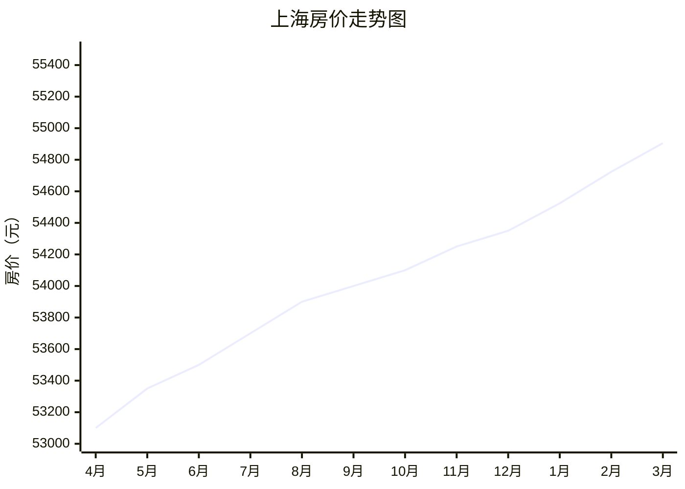

**最近**，经济增长率进入了5时代，后面还会有4、3的时代，这是趋势，大家别惊讶，不是光因为过去行情好，更是因为体量大了，基数上去了，这是发展的规律，也是必由之路。疫情等突发因素，地缘危机等，仅仅是偶然性外部事件，不影响大的趋势。

以上这条路，已经有很多经济体帮我们验证过了，当下最高的人均GDP出现在西欧小国，有十来万美元之多，美国自身在五六万的样子，韩国3万，我们则刚跨过1万美元大关不久，预计2022年会接近人均1.3万美元。这是迈向中等发达国家的门槛，此时的特点有很多，主要特点就是开始正规化。

类似“先污染后治理”的阶段，大致是十年时间，这期间税费开始正规，地税、国税重叠的部分会开始清晰。

网上做生意，线下实体店，都要注册公司，因为你不能有了营业收入而不纳税，即使你是个网红带货赚差价，或者学校门口卖烧饼，或者你开个网店卖课程，或者你做咨询收费用，都是应税收入。

可以说灰色收入越来越少，给你个100万你如果不能提供这钱的来处，恐怕你不敢花，花出去可能就“害人”，害了给你现金的人。

我看电影《20万英镑》，一对英国小夫妻家里突然某天来了不速之客，实际上是警察，警察问：“你俩平时银行往来流水每月大概四五千，为何最近这两个月爆涨到了一两万、两三万英镑？请你们提供下解释，钱的来处。”

男主人公反应还算快，回答道：“我工作之余帮好友Jerry做点家装设计，最近也顺便帮他做点杂活，有了额外收入。”

警察听后，将信将疑，但这毕竟是解释通了，所以警察没多说，留下一句，“好的，暂时没问题，不过你们要是流水再次出问题我还会来。”

以上说明资本主义国家对个人的监管更加无孔不入，而根据这个发展规律，我们也会走到这一步。这个过程大概是十年，2030年后会达到我所述电影里的这一幕。

大概半年前，我们有群友惊呼“断电了！停电、停工！”我特地写了这篇《》，大家现在再去看看，是否预测准确。你们公司还因为被拉闸限电而停工不？

其实那次拉闸限电的根本原因，是我国第一次因为环境保护需要，而限制了碳煤的使用，从而造成了电力不够用。主因是环保，就是碳达峰、碳中和等承诺和环保方面的目标。这个过程对应的就是环境方面的“先污染后治理”，以后高能耗、非环保和低端产能，至少会不断被淘汰，或者被从大城市移到小城市去，从市区搬到远郊区。

从创业的角度来说，目前已经达到了创业失败率的峰值，差不多1000个人创业也就四五个能成功，都不到百分之一，你按照0.5%来算吧。我不敢保证这5‰就是底，但是无论如何这五六年期间会触底反弹，大概从2028年开始中国的创业成功率会开始提升。此后逐渐走高，预计在2038年恢复到市场经济体的平均值，即5%的成功概率。即使如此，届时创业也不是人人都成功，20个才1个成功，但远比当下的1/200要好多了。

目前在2022年，属于我们经济改革的第44个年头，这个第40-50年的十年过渡期，就是“先污染后治理”的过程，其他发达经济体也走过同样的过程。就房价而言，未来10-20年大致如此：全国房价均值年均增长1-2个点，而人均收入继续增长5-7个点，靠两者的率差4-5%去慢慢将房价收入比，从当下的20-50倍，拉平到世界平均水平的3-8倍、大城市10倍上下的合理区间。

其实这个具体的趋势和年份，我甚至这里都写**了，《》。房价收入比回到合理区间的年份大概在2037-2042年之间。

房价也是先污染后治理的模式。有人可能不懂这个比例，我举例，比如上海的职工社平工资，去年按照社保基数来，是10338元/月。市民一年的平均年收入乘以12个月，则是大约12.5万元。夫妻俩加起来为25万。

> 上海社保缴纳基数 精选  
  法律分析：2021年7月1日-2022年6月30日上海社保缴费基数上下限。缴费基数：10338元/月作为计算社保缴费基数，缴费基数上限：31014元/月，缴费基数下限：5975元/月。
  法律依据：《中华人民共和国社会保险法》第四条中华人民共和国境内的用人单位和个人依法缴纳社会保险费，有权查询缴费记录、个人权益记录，要求社会保险经办机构提供社会保险咨询等相关服务。个人依法享受社会保险待遇，有权监督本单位为其缴费情况。

一对上海夫妻，不太计较老房新房、地理位置，准备买1套100平方的二手房，很明显正常目前需要549万元。

这549万除以夫妻二人的合计年收入25万/年，得22年。这个22即为当下2022年上海的房价收入比。

**上海3月二手房均价54905元/m²**
上海2月二手房均价 54724元/m²
环比上月持平，同比去年同期上涨3.45%↑

按照上文“先污染后治理”的理论和趋势，大概会在2037-2042年之间，上海的该比例降低到11上下。这是经济规律，不管具体年份的限购、限贷、限售还是首付比例、贷款利率如何变化。

这个大规律估计好多人不懂，其实就跟当下2022年的面试成功率一样，当下你去面试大概5-6家，才会有一个相对尚可的Offer，你才面试了3家没有就业意向就别说自己“运气不好”。2016-2019年的面试成功率是4-5家一个Offer；2009-2015年大概面试3-4家一个入职通知；2002-2008大概面试2-3家一个Offer；你都难以想象，在1996-2001年，大学生出来面试，只要参加2个面试就有一家愿意录取你。

​**以上就是行情，其实跟你个人的求职水平，关系并不大**​。这句我的铁粉才能明白。

但是个人随着自己这次求职中的面试熟练程度的提高，你刚开始的6次面试才能获得1个Offer，后面面试效率会提高，第7-12个面试就能提高到30%的成功率，继续第13-19个面试，你甚至觉得自己已经达到了50%的面试成功率，继续，在第20个面试后你就开始飘了，“我面试一家成功一家！”因为事实也如此，几乎接近100%的成功率，你甚至根本都不在乎今天的这次面试，对面试官你颐指气使，居然对方还是要你下次继续来复试、终面、谈工资，哈着你来报到。

讲到面试成功率的行情随着年代的变化，那么后面呢？是的，2023-2028年，根据我的预计，面试成功率会继续走低，大概在2025年会迎来极低值，正常面试10家才有一个报到通知。这就是“污染”的鼎盛时期，也是求职尤其跳槽者的行情谷底。

此后开始向上恢复，2030年大概可恢复到2019年时候的行情。在2035年后，一直维持每面试3-4家一个Offer的行情不变，这是成熟市场经济体的面试成功率，当下2022年的美国、英国、德国、日本、新加披、法国、澳大利亚、加拿大以及中西南欧十来个发达小国，就是这个行情。大家别奇怪，以上提及的所有国家，我都有不少职场徒弟在就业。

还有很多经济规律，我就不一一列举了，但是我们职场人是活在当下的，目前这个2022年处于市场经济先污染到40年再开始治理到50年的过渡期，也是此前四十年粗放式增长下“污染”最严重、房价收入比最高、996加班、不负责任的裁员、骗子横行、小老板跑路、环境污染等等，最严重的时候，我们职场人应该怎么办？

我的建议是，你耐着性子，按照我说的学会求职技巧、提升学历、买房置业、发展副业即可，你迟早会笑傲职场，只要坚持下去，最晚2030年你就会发现自己比绝大多数同班同学要收入高、资产多、更富有。

总之，届时不谈买公司自由，但至少买房或者买辆好车自由，还是没问题的。那时你再看你的同学，他们大多还在算计超市购物结账时要不要拿掉几样东西，因为超出预算了......他们连超市买日常用品都还没自由，更别说你早就跨过去的手机自由了。

但是，这个2022-2027最难过的时候还是要过的，我们来看一个这期间常见忽悠你辞职的手段。

- 昨天晚上6:35
  幽哥领导给我说业务调整岗位没了骗我把离职协议签了结果这个岗位还有其他人接了这种情况我能维权吗
  坐标xx
  凌晨1:26
- 签了字就来不及了。

大家注意下，这招经常被用，我们群友已经上百个被如此忽悠得突然失业了。被忽悠的人，一般毕业0-5年，截图这位群友都毕业10年了也中招。

组长/主管/领导/大领导等都有可能以情感人，让你主动离职。就跟老板哭哭啼啼跟你说都卖掉了所有房子、倾家荡产，已经资不抵债了，生意不行，即将倒闭。所以来劝你走，好离好散，配合你的下家背景调查，“我对你好，只跟你一个人说了，你可以早点走......”结果，你实在不忍心，你就​**当天主动去人事部门办理了辞职手续回家了**​。

这个忽悠，就会在2022-2027年之间愈演愈烈。其实何必呢？不就为了省几个月赔偿金？要么安排一个关系户进来？

下一个，看起来是大公司，录取你时说一年30万。大家看下实际情况。

- 入职的时候号称30万，然后10万年终奖没了，然后还降薪，剩下14万就是我
- 😁️好像还是国企吧！
  写下难了，老公以为你藏起来了16万。
- 我觉得就是个创业公司作风
  毛线国企

所以，大家不要看到那种“我们年终奖很高”“我们一年18薪”“28薪”你就高兴，大多数是忽悠你的。此种忽悠将会在2022-2027年发挥到最高水平，即使看了我的文章你都很容易栽跟头，这就是污染最严重的岁月。

- 您好，看了幽哥关于国企的分析深有体验，咨询下，央企二级公司下的混合所有制三级公司，职位部门经理级技术总师，三级公司成立刚满一年，通知第二年薪酬比例大幅调整，从薪酬比80:20到50:50，而且业绩经营面临疫情影响困难，本人年近40，考虑平时薪资生活压力，计划离职跳槽
  星期一09:22
- 一般找到体制外翻倍的年薪，
  可以跳出来，否则得不偿失。
  星期一11:09
- 谢谢幽哥，我现在处于国企民企混合所有制，或者说是国企初创型公司呢，也算体制内？
  昨天23:28
- 半体制内，类似大民企，就按照同城跳槽加薪30-60%吧，可以跳。拿到报到通知再提出离职。

以上三个知识点。

**​一，​**薪酬比，会调整到不利于你的比例。

**​二，​**即使如此，也还是待着为好，国企子公司，算半体制内工作。

**​三​，**如果想走，同城跳槽年薪增加30-60%可跳，跨城市去一线得工资增加80%方可，不然成本过高，得不偿失，并且迟早后悔。

不多说，以上全文以点及面，讲了这样一个2022-2028年的特色，“污染最严重同时刚开始治理”的阶段。

最后，你问：**答应的年薪30万，一年下来为何只有14万？**

回答：**行情如此，2022-2027年体制外就常见是这个样子，也属于此特殊期间的特色。**

祝各位事业顺利，守得穷，耐得富！

End

---

