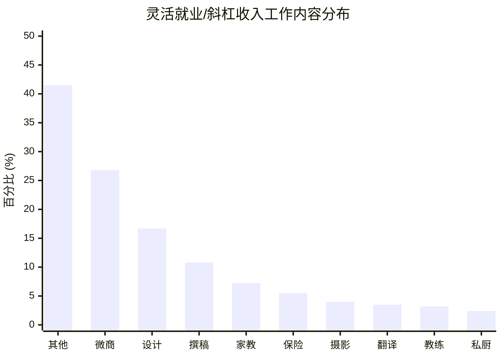

今年关于孕妇被辞退，怀孕不报备扣绩效的新闻层出不穷，生娃不知不觉成为了时下职场女性的痛点。

此前有个微博热搜，说22到28岁是女性生育的最佳年龄。出乎意料的是评论区里却整齐地高举“不婚不育保平安”的大旗。

> 中新網	中国新闻网	十关注	
  CHINANEWS.	7-25 13:08 来自微博weibo.com	
  [专家:#女性22到28岁生育最佳#，你打算什么时候生?】25日，健康中国行动推进委员会办公室在北京召开新闻发布会，会上中国工程院院士、北京大学第三医院院长乔杰介绍，要想生一个健康的宝宝，最重要的是适龄婚育。育龄期夫妻最好在25-28岁科学备孕，这是最好的生育时间，女性从22岁到28岁都是生育的良好时机，生育健康孩子的机会也是更多的。因为卵巢功能的衰退，女性在35岁以上出现异常的概率就会明显增加。(记者张尼)
  你觉得女性多大生育最合适?
  22-28岁	49.1万人	
  28-35岁	44.4万人	
  35岁以上	6.1万人	
  我有别的想法	26.4万人	
  126万人参与 投票已结束	@中国新闻网 创建	
  转发	评论	赞
  中新網
  返回	____	中国新闻网	
  转发2.2万	评论6万	赞265万	
  软萌倩	铁粉	
  不婚不育保平安
  邻家花美男张丁丁等人共517条回复>
  7-25 13:17	2.6万	
  名侦探李白白
  我有别的想法:不生。
  umixing等人共570条回复>
  7-25 13:11	2.1万	
  白衣不送酒而已	铁粉	
  他来了，他来了，他带着阴谋来了
  MIKENOTMACzzZ...等人 共277条回复>
  7-25 13:27	2万	
  爱吃螺蛳粉的小蒙
  我最穷的年龄阶段你建议我生孩子!你特么的是在开玩笑?不过幸好，因为我早在22岁前就决定不生了

另有资料显示，最让现代女性纠结是否生娃的原因有这几个：

> 孩子养育成本高，收入可能负担不了。

> 事业上升期去生孩子，恐怕回来已经被替代。

> 生活工作难取得平衡，担心被辞退。

22到28岁这个年龄段的女性，有的刚步入职场，有的刚在职场站稳脚跟，在变强变大之前，任何变动都会让她们措手不及。

但是想深一层，对于大多数职场女性来说工作是唯一的生活保障，因此对生娃恐惧，其实就是对工作危机的恐惧。

## **01** **不甘于现状，又不肯加以改变**

公司财务部有几位30出头的女同事，工龄最少的都有6年。她们每天的工作就是对对报表，贴贴发票，到月末再写个工作报告就可以交差，清闲而惬意。

她们工资不高，相比刚入职，几年来最多的那位就涨了850元。

**而经常说要学习开拓副业的是她们，最快打脸的依然是她们。**

因为她们一有空闲时间，不是看小视频就是网购，上班也是在微信里群聊各种八卦，明星恋情、网络段子。

她们的聊天有多热闹，办公室的键盘声就有多喧闹。

甚至旁边的设计师已经做好一整本画册的排版，她们还只是打开了微信聊天窗口。

**尼尔·****波兹曼在《娱乐至死》中这么说：“****毁掉我们的不是我们所憎恨的东西，而恰恰是我们所热爱的东西。”**

相比起学习，不用动脑子就随手可得的娱乐方式，的确能让人快速地拥有快乐。

但它更大的作用是浪费时间，将工作碎片化，让人沉溺其中不能自拔，像被温水煮的青蛙一样，等发现职场危机时，想“跳出来”都有心无力。

早前掀起话题的唐山36岁女收费员，因为收费站被取消，她大闹道：“我今年36岁，除了收费我啥也不会。”

多年的收费工作，早已经磨去她的斗志。在最该拼搏的年纪没有居安思危，等到不可抗因素来临，才知道自己无路可退，眼巴巴地看着自己变炮灰。

**而真正聪明的职场女性，都懂得不吃学习的苦，就要吃生活的苦。**

## **02** **追求斜杠的女人，都活得底气十足**

躲在舒适区不肯出来的人很多，但是敢跳出来的人更多。

做会计的好朋友小君，在一家互联网公司上班，由于公司整改，3个月前被裁员。

就在大家都想着怎么安慰她的时候，却看到了她po出“本人设计工作室正式成立，欢迎新老客户砸单”的朋友圈。

原来早几年在业余时间，小君就开始自学设计，学成后自己接单，还在一些设计网站上做了兼职设计师。

之前朋友聚会时，有人问她那么辛苦为了什么，女孩子轻松一点不好吗？

> 你想过这样的生活这些选择是必须的

**她笑说：”如果将玩手机的时间用来学习，性价比不是更高吗？”**

而现在，副业带来的收入，早就远超她本职工作的收入。

**也就是因为有了副业，小君才能如此从容地面对裁员，面对失业。**

更重要的是，副业不会失业，它比主业更加稳定，这意味着小君此后的人生，都能活得底气十足。

根据智联招聘《2019职场人年中盘点报告》数据分析显示：约有8.2%的职场人拥有副业收入。

占据前三的是微商、设计和撰稿。这些职业不受时间地点限制，只要你肯用心做，实现收入大幅提升不再是天马行空。

而当你本来就是名校毕业，或者拥有某领域的专业知识，家教、保险、翻译等行业都值得去尝试。

> 统计规则：基于智联招聘2019年职业教育人才统计数据分析
  数据来源：智联招聘 (www.zhaopin.com)

追求斜杠的人生，的确比呆在舒适区要付出更多心力，但是你为未来做的打算，每一步都算数。

**正如著名的费斯汀格法则说：生活中的10%由发生在你身上的事情组成，而另外的90%则由你对所发生的事情如何反应决定。**

职场女性尽管不能控制生活的变化，但是有化被动为主动的能力，也是一种底气。

**现在很流行一个说法，下班后的2小时，决定了你跟别人的距离。**

很多职场女性踌躇满志，摩拳擦掌准备大干一场，却发现完全无从下手。

## **03** **35个赚钱支点，手把手教你开拓副业！**

很多人想要靠理财增加工资外收入，却苦于没有本金。

幽哥根据自身副业经验丰富，尝试并投资过十几种副业，副业收入超过了主业工资的3倍以上，整理了一个副业课程，梳理了**35个赚钱支点**，开发了**《工资外收入如何从0到月入10万》**这套课程。

这套课程一改传统方式，让普通的上班族也能收获工资外收益，更重要的是避免副业上的弯路。主业的弯路，浪费的是时间；副业弯路；迅速吸食的可就是你的存款、资产和信誉了。

End

---

