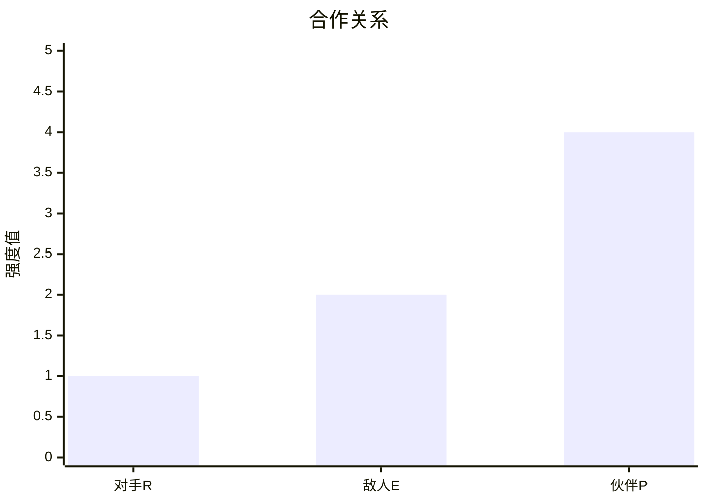
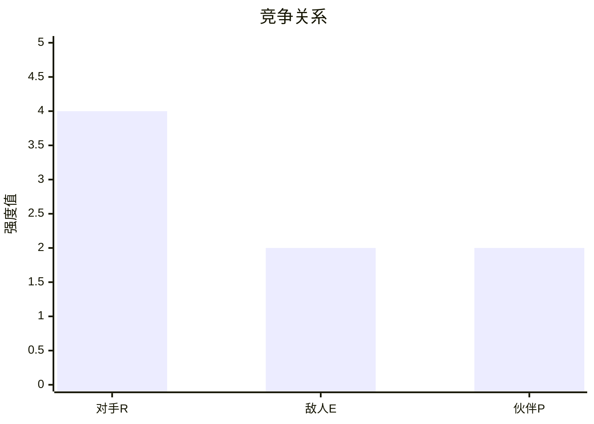
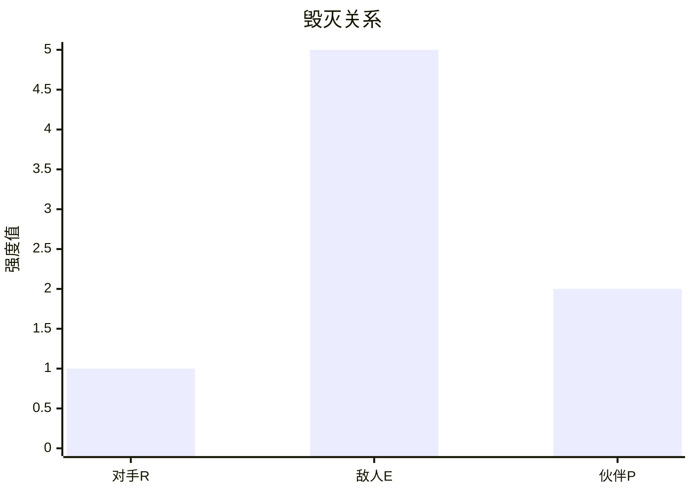

**前言：本文阅读时间4-6分钟。建议先mark，再仔细阅读。本文建立了同事之间的关系模型，属于量化关系的代表作，非常经典，对职场人际关系具有极大的指导意义。**

​**进入职场后的首要问题**​，就是如何处理跟同事之间的关系。作为一名新入职的员工，我们需要老员工帮助，也想迅速融入职场，这就要和别人建立关系，以便于开展工作。

**​同时，​**在这个过程中，我们也不免被一些同事无视，孤立，排挤，挖坑，穿小鞋，打小报告等等。原因多种多样，可能因为工资比同岗位员工高，可能是空降的管理层，可能身材外貌学历鹤立鸡群，也有可能因为自己唯唯诺诺的性格，原因不一而足。

有些人把同事，当做同学的关系来看待，认为和同事之间没有利益冲突，应该互帮互助。但有时候发现竟然在请教一些Excel上的小问题时，同事都告诉自己说他不会。

有些人把同事，当做朋友闺蜜基友来看待，认为想要迅速融入职场，就要跟同事打成一片，坦诚相对，甚至把自己的生活，隐私，工资，恋爱等等都跟同事分享。没过多久，就发现全公司都是自己的八卦。

有些人把同事，当做敌人来看待，像防贼一样防着同事，当然面临的就是相互撕逼，内卷，被孤立，被排斥，甚至很难开展自身和团队的工作。

**​更有甚者，​**把同事当做无息贷款的借款机，发泄情绪的垃圾桶，免费使用的劳动力，八卦谈资的主人公等等。

当我们以单一的视角，想当然的视角来看待同事时，势必陷入各种各样的麻烦中，不仅不能顺利融入职场开展工作，甚至会被这种不健康的同事关系所伤害，阻碍自己的工作绩效，每天身心俱疲，无所适从。如果无法从这样混乱的职场人际关系解脱出来，就更别谈什么加薪升职了。

**因此，步入职场后，必须客观辩证的对待同事关系。**

同事关系，不是无利益冲突的同学关系，也不是志同道合的朋友关系，更不是你死我活的敌我关系，或者其他无息借款机，情绪垃圾桶，免费劳动力等等畸形的关系。

我们与同事之间的关系，不是主动构建的关系，自愿发展的关系，而是由于工作任务被动构建，被迫结合的关系。这是一种强制性的结合，当然这种结合之中会存在种种的矛盾和冲突。因此，在工作中，必须小心谨慎的平衡，控制，消除这些矛盾和冲突。

我们与同事的之间关系，都是基于使自身的利益最大化而被动结合在一起的。 基于自身利益的冲突的大小，我们可以划分为三种关系。

## **关系1：伙伴，合作关系。**

当工作任务需要双方合作才能完成，双方的利益不冲突，合作能使得双方各自利益达到最大化时，此时就会形成一个伙伴关系，无论我们喜欢不喜欢对方，都要互帮互助，这是基于对方能为自己带来最大的利益。其他一切的矛盾，和冲突都是次要的，都要被设法克制，消除。

比如某个跨部门合作的研发项目，某个跨领域的技术攻关，某个团队的销售业绩，某个质量问题，产品问题，技术问题的解决方案等等。当然，这个合作的过程中，存在一些甩锅，推责等，但是这事关所有人的团队绩效，任务完成度等，因此矛盾和冲突都会压制在很低的程度，最终会达成一个所有人都认同妥协的方案。

此时我们对待同事就要帮助他，引导他，甚至更加坦诚一些，主动理解他的想法，发现他的难处，同时分享一些重要的技巧，方法，工具等等，尽快产出一个得到大家认同的最优解决方案。

## **关系2：对手，竞争关系。**

当工作任务的合作程度比较低，双方的基本工作任务不冲突，但是最终的工作绩效评价会有一些冲突。自己利益最大化的同时，会妨碍别人利益最大化。因此在工作中，双方就会互为对手，产生竞争关系。此时的矛盾和冲突是良性的，可以控制。只要尽自己能力，把自己的工作任务完成，就有可能在工作绩效评价中超越对方。

作为对手，进行平行竞争，只是自己利益最大化的同时，别人利益受损程度较小，不是让别人没有利益。

比如某部门年终绩效评定，小张得到绩效评价A，拿5万年终奖，小李得到绩效评价B，拿到4万年终奖。小李不会认定是小张把自己的5万元拿掉了，因此仇恨小张，而会认为，小张确实表现优秀，或者领导偏爱小张，或者考评方案设置不合理，或者自己确实犯了几个明显错误，等等。

此时，我们应该尊敬对手，学习对手的优点，反省自身的缺点，并且理性看待客观条件，评价方案，领导喜好等等，来年再战，一较高下。结果是相互促进，能力提升，互有胜负等等。

当然这中间可能会产生向上级打小报告，给对方的工作制造一些小麻烦，在对手遇到困难时，袖手旁观，落井下石等等。这些冲突和矛盾基本上还是遵守游戏规则，通过自身的纠正，努力，就可以掌控局面。

## **关系3：敌人，毁灭关系。**

无论工作任务合作程度的高低，自己利益最大化会损及对方的基本利益，或者对方利益最大化的同时会损及自己的基本利益。注意，一方利益最大化的同时，损害的是别人的基本利益，而不是别人的最大化利益。那么此时做出这种行为的同时，就是敌人，他的目的不仅要最大化自己的利益，还包含毁灭对方。

**这种“职场敌人”现象也很多，内外部都有，比如：**

部门内，小美经常散布小娜的八卦花边，经常向小娜的上司打小报告，经常栽赃抹黑小娜；

技术部门，由于技术不成熟造成的产品损失，甩锅成是生产部门的管理问题；

研发部门的设计缺陷，甩锅为销售部门的营销问题；

上级PUA员工，强制员工加班，辩称是下属态度问题、能力问题；

公司违法辞退员工，不愿赔偿，甩锅是员工违反公司制度、能力不能胜任的问题；

空降领导给你穿小鞋、差评、引导你主动提出离职并去人事处迅速办理离职手续，等等。

这种情况下，同事之间就是敌我矛盾，是一方要毁灭另一方的巨大冲突，这是你死我活的关系。此时必须狠下心来，奋起反击，给予敌人严酷无情的打击。

要么通过各种手段迫使对方，不敢再对自己动坏主意，动坏心思，大家井水不犯河水，相安无事。

要么就直接从“肉体”消灭对方，让其离开这个公司。

​**当然这种敌我矛盾的斗争，可以是明面的，也可以是暗地进行的**​，既可以是联合其他同事，孤立、排挤敌人。也可以是抓住敌人的弱点、失误、要害，猛攻其七寸，一撸到底等等。

这些厂长以后都会在公众号文章中详述，并列举具体方法。

## ERP系统

为了便于记忆，我们把**​合作关系：伙伴（​**​**Partner**​​**）**​，**​竞争关系：对手（​**​**Rival**​​**）**​，**​毁灭关系：敌人（​**​**Enemy**​​**）**​，英文取首字母简称**ERP系统**。

​**粗略来看**​，同事就分以上这三种，不信你现在就可以将你周围的同事分下，都能让他们进入各自类别中。

但是，在实际的职场生活中，也并不是就能如此孤立地将同事简单区分为伙伴、对手，还是敌人，因为随着工作任务的变化，绩效评价的变化，利益关系的变化，等等，每个同事之间，都是ERP的混合体，都存在着伙伴、对手、敌人的因素，只不过在某个阶段，不同因素所占的比重不同。

因此，我们跟同事之间，存在着既合作，又竞争，甚至还要相互斗争的矛盾关系。不同阶段，可能合作占主要地位，也可能竞争占主要地位，也可能斗争占主要地位。这都要具体问题具体分析。

​**这里给出一个分析的工具，把我们跟每个同事之间不同因素的强度，进行量化**​，这样就可以通过量化表，对不同关系的同事，进行区别对待。辨别出谁是我们的合作伙伴，谁是我们的竞争对手，谁是我们的敌人。

每个因素(**伙伴P，对手R，敌人E)**分为5个强度等级。最低为1，最高为5，根据平时同事之间的相处，沟通，工作任务分配，利益冲突，个人喜恶等，在三个纬度进行打分，并制作雷达图，来进行可视化区分。

| 伙伴型同事 | （P型） |       |       |
| ---------- | ------- | ----- | ----- |
| 维度       | 对手R   | 敌人E | 伙伴P |
| 极限       | 5       | 5     | 5     |
| 强度       | 1       | 2     | 4     |

| 对手型同事 | （R型） |       |       |
| ---------- | ------- | ----- | ----- |
| 维度       | 对手R   | 敌人E | 伙伴P |
| 极限       | 5       | 5     | 5     |
| 强度       | 4       | 2     | 2     |

| 敌人型同事 | （E型） |       |       |
| ---------- | ------- | ----- | ----- |
| 维度       | 对手R   | 敌人E | 伙伴P |
| 极限       | 5       | 5     | 5     |
| 强度       | 1       | 5     | 2     |

**​这个评分表，最低分1分，代表所有的同事都具有潜在的合作，竞争，敌人关系，只是目前跟我们的关系强度比较弱而已。​**在某个阶段，工作任务的变化，个人利益的变化，部门利益的变化等等，每个同事之间都有可能在某一个维度上出现明显的改变。

**也有定性的关系，也就是战略决定的关系，一般变化没那么快。**

​**某个党派内不同成员之间，见解甚至政见都有分歧，有时候会摆你一道，但他们主要还是合作关系**​；党派之间的斗争，这类似民主共和两党的竞争，更主要是为了夺权，互相牵制偶尔诋毁，这是对手关系；站在国家治理更加和谐、人民获得更大利益时，就要一致对外，保护本国利益尤其根本利益，所以这两党会在涉及他们国计民生的时候保持战略一致，共同面对外部的敌人和各种风险挑战。

**​以上三个关系都是战略决定的。​**具体可以这么来看，共和党之前的总统特朗普，跟共和党内部大佬之间，主要是合作关系；跟民主党大佬佩洛西之间，实际上是竞争对手，特朗普跟包括跟他争夺总统宝座的拜登之间，也是竞争关系；在1月中旬，拜登即将上台前，也发推写过一句话：“我们是对手，不是敌人”。

**记者随后曾追问过：“我们的敌人是谁？”**

**拜登愣了几秒，这么回答道：“是俄罗斯。”**

**记者显然对这个回答不满意，就追问：“中国呢？”**

**拜登回道：“中国是我们的竞争对手，不是敌人。”**

**其实我们从上文的ERP系统来分析可知，**外部尤其实力相当的挑战者，明显是两党共同的敌人，不是对手，拜登是想对于外部的力量先矮化或者美言大多数，唯独认准其中一个敌人，这才好将外部敌人逐个击破，一次只认准一个敌人，以免双面夹击或者“多处开战”。他这句话采用的是偷换概念的方法，来麻痹暂时非必要不收拾的敌人而已。

**回到职场中，同事之间的关系变化较快。**

在与同事合作的阶段，要意识到这种合作关系中，也潜藏着对手和敌人的因素，要时刻保持警惕；

在与同事竞争的阶段，也要意识到这种竞争关系中，同样存在着伙伴和敌人的因素，要做好最坏的打算；

在与同事斗争的阶段，更要意识到这种斗争关系中，还是会有一些伙伴和对手的因素。我们不一定要赶尽杀绝，你死我活，也可以用高明的手段化敌为友。

**这就是E.R.P分析法，通过量化分析，我们可以把同事分成两类，一类为强关系同事，另一类为弱关系同事。**

**​某一个纬度关系达到4及以上，就是强关系同事，​**此外，都是弱关系同事。在职场中，把主要精力放在强关系同事的身上，用少量的精力维持跟弱关系同事的感情。

**这样在职场工作中，我们就能很好的对应不同的关系，根据不同的关系强度，与不同的同事，进行区别化的交往。这样更利于我们开展工作，化解职场危机，构建职场关系。**

在后续的文章中，我会再继续分析如何处理**跟**​**HR的关系，跟领导的关系，跟下属的关系**等，搭建一个横向跟纵向相结合的系统化职场关系生态。

End

---

**大家可以在公众号“厂长大人”中，看到后续的文章更新和案例分享。**

