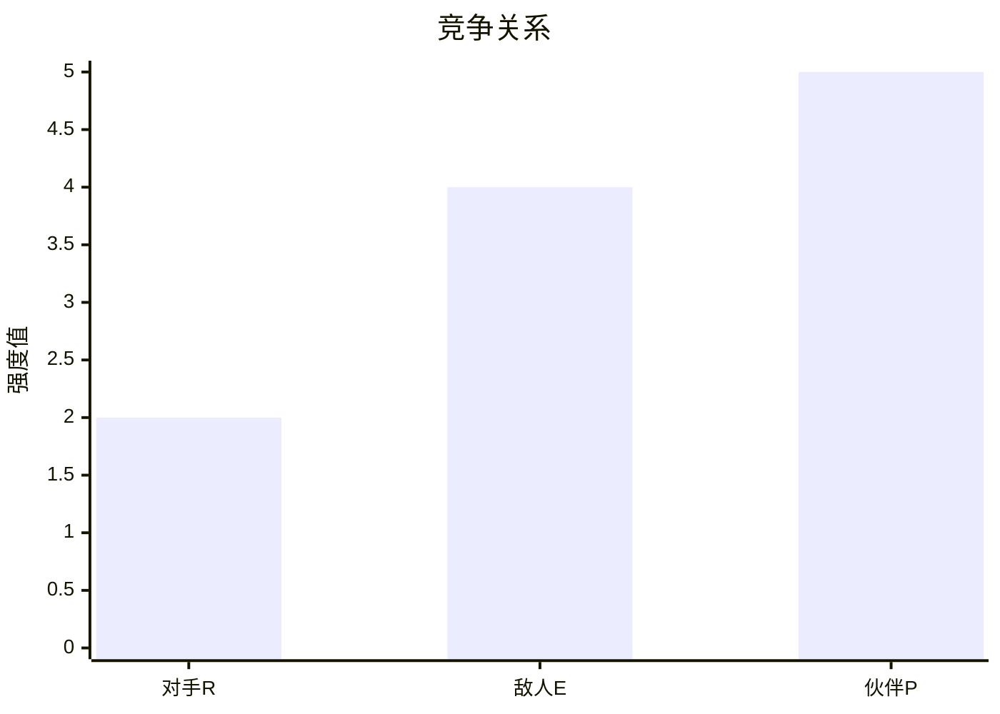
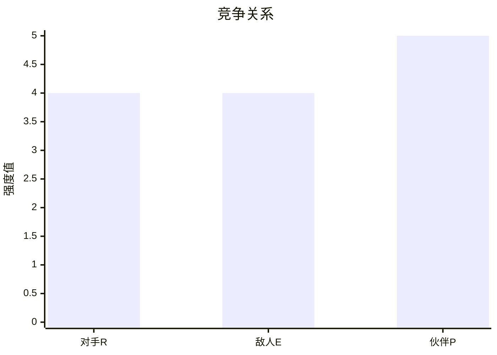
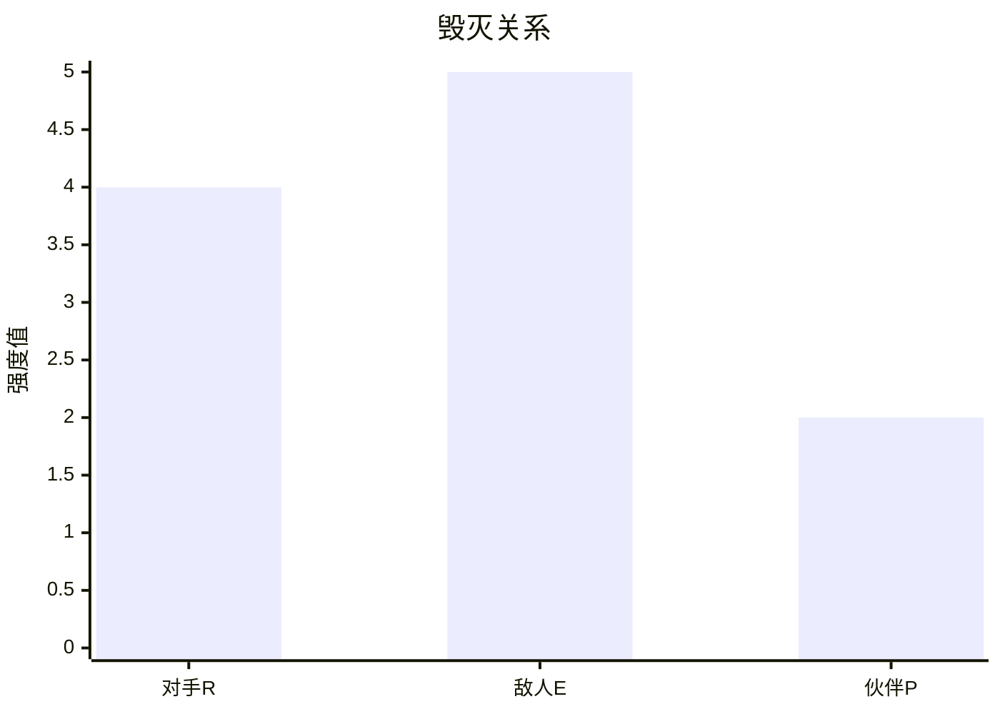

## 不想当将军的士兵不是好士兵

**1926年3月20日**，时任黄埔军校校长蒋介石，通过策划“中山舰事件”，发动反革命政变，实质性的掌握了国民政府的军权，政权，和国民党的党权，是名副其实的中华民国“总裁”。

**实际上，此时蒋介石名“总裁”，而非实“总裁”。**

蒋介石通过权术上位，笼络人心，以人民为奴隶，以下属为家仆，以公权谋私利，这就是名“总裁”。而中华民国需要的真实“总裁”，是要践行三民主义，争取民族独立，国家富强。

**虽然名为“总裁”，实则欺世盗名，窃国自肥之徒。**

> "不想当将军的士兵不是好士兵"-拿破仑。

​**这句话的意思是**​，一个优秀的士兵应该努力让自己具有将军的格局，视野和思维，这样才能发挥主观能动性，知道自己应该在什么时间，出现在什么位置，与谁配合，向哪里进攻。

​**当然**​，这样的士兵，做将军也是合格的。

​**而不是一心只想通过权术，关系，行贿等方式，获得一个将军的职位**​，贪图“将军”之名，这样还不如自封自己一个“将军”，免得使自己手下因为自己的愚蠢白白送了命。

> 故战道必胜，主曰无战，必战可也；战道不胜，主曰必战，无战可也。故进不求名，退不避罪，唯人是保，而利合于主，国之宝也。
> 
> 《孙子兵法》

​**做将军的目的是为了打胜仗**​，有利于国家，有利于人民。而不是求名，牺牲别人的利益，把别人当作自己的垫脚石，一将功成万古枯。

​**恰恰远在遵义会议确立教员的军事领导权之前**​，在许多共产党员在对前途充满疑虑时，教员便写出了《中国各阶级分析》、《红色政权为什么会存在》、《星星之火可以燎原》等一系列极赋远见性，前瞻性，深刻性的文章。其格局之大，视野之广，见解之深，频频在生死存亡之际，挽救了红军的有生力量，为共产党的发展指明了方向，为解放全中国埋下了伏笔。

> “进不求名，退不避罪。”
> 
> “知兵之将，民之司命，国家安危之主”

**​因此，在职场中我们构建良好的职场关系，不是为了牺牲别人利益，往更高的职位爬，企图以权谋私，获取更多的利益。​**而是放眼全局，解决职场关系中非必要的冲突和矛盾，在尊重别人合法利益的基础上，拿到属于自己的经济回报，同时成就大多数人的职业和事业。

**当然，这很难。**

**成就别人，也就是成就自己**

​**同样**​，如果厂长大人的文章让白嫖过的粉丝都能受益，那么最终成就的还是厂长自己。

## 如何构建与处于相对中立状态同事的职场关系

​**言回正传​**​，

在上篇《》中，我们确立了正确的职场战略，这个职场战略每个人可以根据自己的实际情况做适当修正。并分析了两种如何构建与处于相对中立状态同事的职场关系。

**本文延续上篇话题，继续进行分析。**

**​对处于相对中立状态的同事，我们的做法是尽量争取和沟通。​**尽可能的消除双方的敌对因素，降低双方的竞争强度，改善双方的合作关系，寻找更多的共同利益点。

**1.& 2.请点击**​**《》**

### **3.   敌人&伙伴型（E.P型）同事**

| 敌人&伙伴型 | （E.P型） |       |       |
| ----------- | --------- | ----- | ----- |
| 维度        | 对手R     | 敌人E | 伙伴P |
| 极限        | 5         | 5     | 5     |
| 强度        | 2         | 4     | 5     |

敌人和伙伴型同事，在某段时期处于一个共同合作的态势，但同时又处于一个互相毁灭的状态，E.P两个因素都非常强。

**这可能是主观造成的敌对关系，也可能是客观造成敌对关系。**

**如**人事部的小美和小娜分别负责人员招聘和薪酬管理两个模块，在工作上必须互相合作。但是两人同时喜欢上了IT部门的王小帅，又互为情敌，想除之而后快。

​**这是主观产生的敌对关系**​，可以通过一方主动退出，消除敌对关系，也可以主动与对方沟通，交流信息后发现王小帅是个渣男，从而产生厌恶，消除敌对关系的因子。

​**在职场中**​，个人的情感关系一定要让位与工作关系，如果确实与某位同事不由自主的坠入爱河，且恋爱关系可能会影响到自己与其他同事的职场关系，那么最好恋爱双方，一方跳槽到其他公司，避嫌。

​**如某公司要推出新产品**​，要求研发部和生产部合作，在1个月内推出新产品。如果不能按期推出有市场的新产品，则通过问责程序，马上解雇研发部经理或者生产部经理。但研发部的现状是研发能力有限，资金不足，能在短期内研发出新产品非常困难，同时生产部的设备老旧，工艺能力差，即便是有完美的设计方案，也很难把控质量。

研发部和生产部都存在自身难以解决的问题，此时高层又不问青红皂白下了死命令，只要结果，不听理由。

​**这样**​，研发部决定开发一款设计简单，但是加工工艺复杂的产品，最后把责任全部推在生产部身上。而生产部也决定，故意在制造过程中做一些手脚，故意让研发部工程师犯错，把所有责任都推在研发上。

**研发部和生产部，相互合作，又互为水火。**

这就是客观条件造成的敌对关系。如果陷在这种敌对关系的怪圈中，很难寻找到突破口。

**此时可供选择的破局方法：**

**1)转移矛盾：**

A. 将新产品的研发工作外包，或者购买外界已有的可行方案。

B. 将新产品的生产工作外包，寻找有制造能力的外包商。

C. 联合对方，将矛头指向做出该决策的高层管理者，想方设法诱使其改变决策，或者联合更高层级的领导迫使其改变决策。

D. 使用制裁手段，发动群众，团结一切可以团结的力量，毁灭该决策者。

**2)转移焦点：**

A . 开发新产品无法创造收益，可以是现有的产品的定价，营销等进行改善。

B．开发新产品有风险，应寻找更低廉的材料，控制生产成本，降低产品定价。

**3)制造更大的矛盾来掩盖小矛盾。**

**如果对方不愿意和自己合作，非要与我们为敌，那么我们就应该使用制裁手段，发动群众，团结一切可以团结的力量，尽早的毁灭对方。**

### **4.敌人&对手&伙伴型（E.R.P型）同事**

| 敌人&对手&伙伴型 | （E.R.P型） |       |       |
| ---------------- | ----------- | ----- | ----- |
| 维度             | 对手R       | 敌人E | 伙伴P |
| 极限             | 5           | 5     | 5     |
| 强度             | 4           | 4     | 5     |

​**该类型同事关系在E.R.P因素三方面都很强**​，在某个时期因为力量相当，所以谁也无法毁灭谁，必须静待形势变化。形势变化的方向，可以是纯伙伴关系，可以是纯对手关系，也可以是纯敌人关系。

**我们应该尽量引导或迫使对方向着伙伴关系转化，尽量消除敌对的因素，解决冲突的矛盾。**

**例如:**

技术部门经理跳槽，空缺出了一个经理职位。作为资深技术主管的老唐，在经理职位空缺期间，公司任命老唐暂时代理经理职位。

2个月后，公司突然从其他行业招聘了一位技术经理小刘入职，老唐只能回到原来的技术主管职务。老唐愤愤不平，认为自己无论从资历，还是技术，还是管理能力，都应该顺利升任技术经理。因此在工作中，老唐就不愿意配合新经理小刘工作。

老唐认为自己必须想办法把小刘赶走，显示自己对公司的重要性，因此联合其他公司跟小刘搞对抗，故意为难小刘，使其难以开展工作。小刘也意识到是老唐搞的鬼，如果不把老唐这个刺头拔掉，自己在部门内难以服众，一年内如果没有任何成绩，公司是不会让自己继续干下去的。

此刻老唐和小刘之间是强烈的互相毁灭关系，敌我关系，你死我活的态势。

但是由于小刘刚入职，不熟悉部门业务，也不懂公司内的关键技术，因此此时拔掉老唐，整个部门可能就要瘫痪。也会搞得大家议论纷纷，一进公司就对老员工下手，影响不好。说不定，老唐跟某位高层领导有亲戚关系，反倒偷鸡不成蚀把米。此时小刘在不清楚老唐底细之前，也不敢轻举妄动，又必须与老唐合作，保证技术部门的工作正常运转，同时也要在别人面前表现出自己的容人之量。

对老唐来说，自己的工作由新经理小刘分配，绩效由小刘评价。如果明着跟小刘过不去，传到了高层耳朵里，对自己也非常不利，毕竟老唐还是想上位的。所以，只能暗地里进行，表面上还要跟小刘一团和气，表示支持新领导工作。此时表面上老唐也必须跟小刘进行合作。

同时老唐非常想当经理，因此在工作中，遇到问题很少向小刘回报，而是直接越过小刘，向小刘的上级回报，展示自己的管理能力。小刘也赶紧熟悉技术部门的业务，与其他员工谈心，争取部门下属的支持，希望摆脱老唐的影响，试图稳固自己的职位。这种情况下，老唐与小刘之间又存在强烈的竞争关系。

**​对小刘而言，​**可以尽力化解自己与老唐之间的矛盾，或者转移矛盾，转移焦点，制造更大的矛盾来掩盖小矛盾，劝解或者迫使老唐成为自己的同盟者。

​**也可以通过绩效上让利**​，工资上加薪，工作上放权，生活上给予特殊照顾等，让老唐认为做原来的工作更轻松，更有自由度，更能实现自己的价值。

​**也可以团结一切可以团结的力量**​，瓦解老唐的联盟，断绝老唐的后援，彻底孤立老唐，让他意识到只有跟自己合作才是惟一的出路。

​**另外，可以将老唐的简历介绍给猎头，介绍给竞争公司**​，或者其他部门有管理职位空缺，举荐老唐去升任等等。

当然作为老唐的上级有很多手段来化解相互之间的冲突，最好是将老唐争取为自己的盟友，寻找更多的利益共同点。

​**如果老唐坚决放弃任何形式的合作**​，那么就必须动用制裁手段，联合同事，团结一切可以团结的力量，毁灭老唐。

**对处于相对敌对状态的同事**​**，**

| 对手&敌人型 | （E.R型） |       |       |
| ----------- | --------- | ----- | ----- |
| 维度        | 对手R     | 敌人E | 伙伴P |
| 极限        | 5         | 5     | 5     |
| 强度        | 4         | 5     | 2     |



​**由于相互之间合作的因素很小**​，很难找过足够多，或者足够大的共同利益点，来消除分析，化解非常强烈的矛盾，即便是能找到一些利益点，也需要花费很大的精力和成本来团结对方，因此必须对这种同事保持高度的警惕。

​**在我们想办法团结他们的同时**​，这些敌人型同事可能在想方设法找我们的弱点，缺陷，准备陷我们于水火之中。在我们发觉时，可能为时已晚，造成的损害已成定局。如果被踢出局，成王败寇，再也没有翻盘的机会。

**​因此对于此类同事，​**我们就要团结群众，团结我们情报型同事，伙伴型同事，团结一切可以团结的力量，全方位搜集敌人型同事的情报，言行，举动，工作轨迹等等，做到知己知彼，先保证自己不犯错，立于不败之地。通过夺取话语权，赢得舆论支持，影响更高层领导的判断，在敌人犯错的关键时刻，发起反攻，给予敌人致命一击。

End

---

