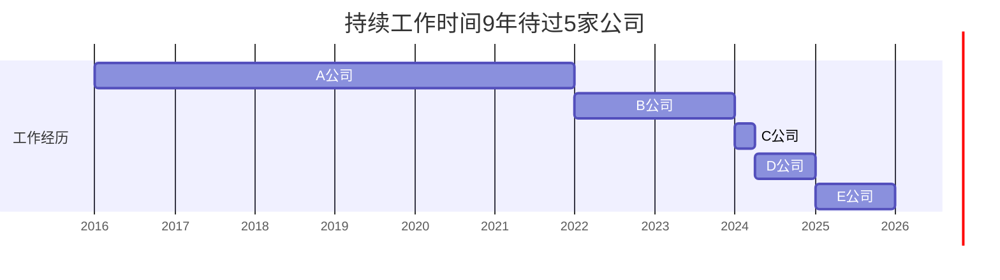

> 🍭大闸蟹聚会点击标题查看详情

---

回到今天的主题“过去跳槽频繁，现在如何求职？”

过去的履历，是自己写就的历史，我们平时要身体力行去呵护。记住，不要：频繁换工作、去不知名的小单位、平薪降薪或平级降级跳槽、职业空档太多、动不动变动城市。此外，行业和岗位尽量有一定的延续性，被裁或辞退并不可怕，但要能解释离职的原因。

现在你的问题是，过去的履历中已经跳槽频繁，那么，下一步要做的就是几年内不跳槽。稍微待一待，让时间飞一会儿，将目前公司的职业长度增加到5年以上为好。

如果非要换工作，那尽量找签订长期合同的大单位，不要去外包，不要去做短期合同工，不找高危岗位，不去创业公司甚至新项目，不要做“底薪+提成”薪资结构的工作，包括各种PKI压力巨大的那些。

还有，比如《》，一个部门甚至一个公司就你1个人，比如《》，将一个人打造成一个部队的，显然都是随时让你失业的工作，不要去。

当然也看具体企业、岗位、薪资和个人情况。本文层层深入，探讨下“过去跳槽频繁现在该咋办”的问题。

# 一，短期待过五六家公司，还断断续续的，都缴过社保，怎么办？



类似的例子我讲过好几次，举例如上图，我们有上百个群友，就曾经是如上这样的履历情况，一般发生在毕业后的头五年，正常，毕业后不进体制这其实就是常态。

也就是毕业后的大致60个月内，他们因为各种原因，一会上班一会不上班，有主动辞职，也有被辞退的，还有自己要学车或者单纯玩半年的，更常见的则是脱产考公、考编、考研、考雅思的......

总之断断续续上班，毕业5年实际只有2年在职，已经待过五六家甚至七八家公司。下一步方法其实就是美化简历了，具体而言你看上图，将四五六这3家的经历保持真实，一二三合并到关系最好能有证明人的那家去。

这也是实在没有办法的权宜之计，否则简历投出去不会有面试电话。其实每个“行当”都有极大值，5年6家公司还算小巫见大巫，我们最厉害的有佛山小悟空29岁时已经待过19家公司，还有重庆小卡36岁时待过28家公司......

这还是他们几年前拜师时的履历，现在又过了五年，待过的公司就更多。频繁跳槽有惯性，但自己可以克制。我看她俩现在工作都做得好好的，大致算稳定了。你想想看，他们这种“地狱”级别的跳槽频繁程度都能度过失业危机，相比较而言你的求职难度要小多了。

# 二，9年待过5家公司，该如何找工作？

相较于刚刚《》的情况，9年5公司已经好了很多。但具体得看这5家是如何分布的，各自的真实长度、离职原因、是否都缴纳了社保。

我们来看提问：“幽哥，你好。我在深圳本科毕业，当行政9年了，工资2w。其中A公司5年，B公司2年，c公司3个月，d公司1年，e公司1年。”

这次是持续的工作，跟开头上百个学弟学妹频繁跳槽、断断续续上班不一样，这位学姐是持续的简历，她的履历布局如下。

显然，只需要去掉那3个月的C公司就行了。这样一来，9年待过4家公司，也就只跳槽过3次，9年/3次=3年才换一次工作，绝对算上不上跳槽频繁。

如果目前的E公司可以继续再待一待，比如3年甚至5年后再考虑换工作，那就更完美了，因为届时人家主要查E公司，连D都不会查了，更不要说短暂的C或之前的B、A公司了。

# 三，过去跳槽频繁，现在只有1个入职意向，怎么办？

> “现在刚刚失业，我找到一份世界500强外包的工作，合同只有一年，工资3w。”

这是失业的情况，好歹花2-4个月好好找找工作。所以不知道这个“刚刚”是多长时间。

如果是已经求职三四个月，那就先去这个1年外包岗位，好歹月薪增加了50%，即一万，尚可，这样流水也上去了，而且一年后合同到期前争取续签。

如果是10月份刚刚失业，那这才离职一两个星期，可以再找找看，同时将这家500强外包岗位拖到12月1号，就说“老家突然有事，实在不好意思！”

如果新公司实在拖不了，而且假设入职1年就不续签，那就提出月薪从3万再加一点，你就回复人事：“我综合考虑了日常开销、上班距离、短期合同、外包岗位等综合因素，也参考了家人的建议，我希望月薪再加个小几千，达到或者接近3万5，我就可以想办法下周一来入职。感谢您帮我争取，入职后我会感谢你的！”

> “我最近2年跳槽太频繁，所以就想是不是再找找个长期的，还是先入职?”

最近2年跳槽是有点频繁，2年待过3家公司，但要看整体9年，你只跳槽4次，美化后去掉C公司，频率是3年跳槽一次，完全不频繁。就像中国各地高速公路判超速违章一样，大概会是对某9公里内平均限速120码，而不是看你某2公里甚至2百米内的即时速率超了120码就算违章。

整体来说，你按照我的建议来：

1. 向500强外包岗位提出加薪到3万5，即使对方只答应3万1，也可答应他们10月内入职；
2. 如果500强一分不让，则你回复：“老家突然有事，得要1个月才能入职，我尽量3-4周内来报到”，这就拖到了10月中旬，利用这一个月加把劲，海投海面找找其他更好更稳定的非外包工作；
3. 如果上有老、下有小、老公失业多年、房贷多、经济压力大、家庭贫困，那就不废话了，下周一立马入职这家500强，当然是以牺牲简历好看为代价换得立马有高薪收入，好在你跳槽的频繁程度还很有余量，只是你自己觉得余额不足罢了。

End

---

